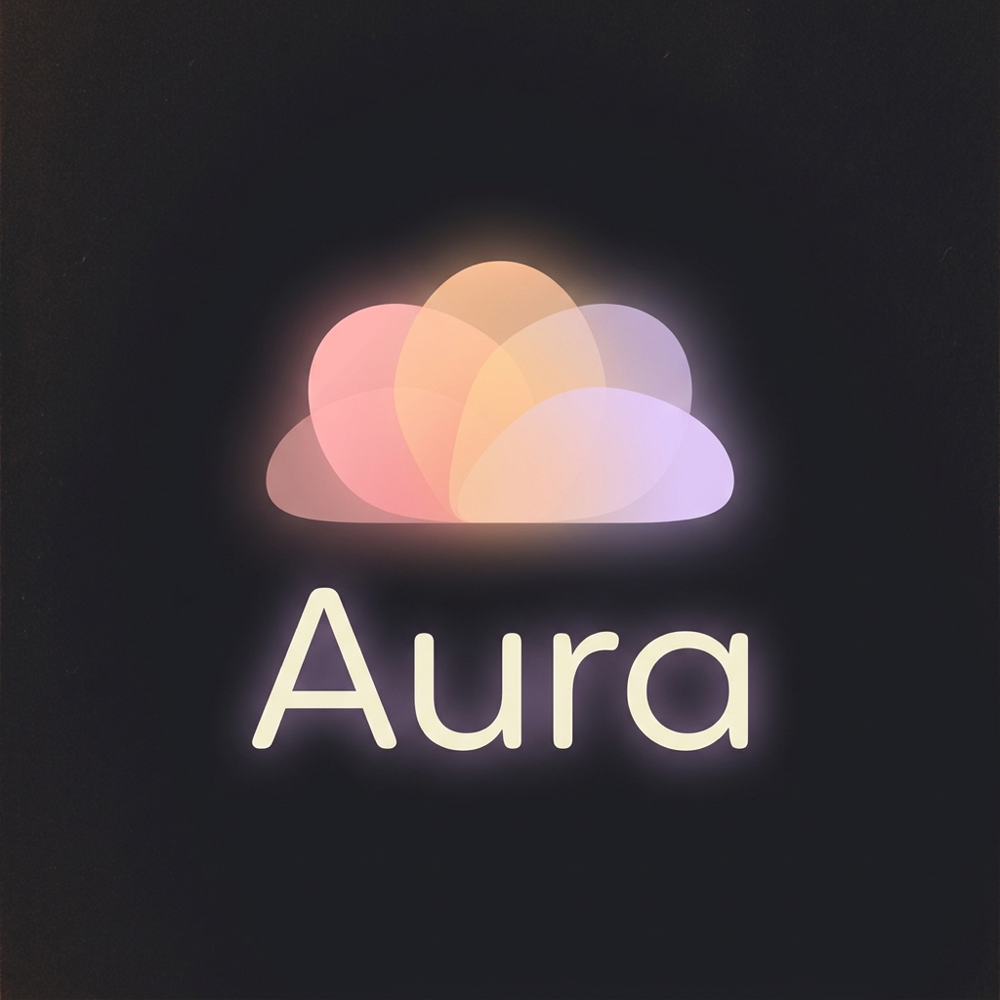

# 💖 Aura

<div align="center">



*Aura 像晨光初透时的微晕，像老唱片转动时的温润声场，也像你疲惫归家、推开门那一瞬心里悄悄亮起的光。*
*它不喧哗，却存在；不强制，却陪伴；不占有，却始终环绕着你。*

---

### 客户端


### 服务端


### AI


### 数据库


</div>

---

## 📖 简介

**Aura** 是一个 AI 陪伴聊天项目，围绕实时对话、长期记忆、情绪感知、主动陪伴和多端体验构建。当前主线由 FastAPI AI 服务承担后端能力，用户端使用 Next.js Web，管理端使用 Vue3，Flutter 移动端保留并待后续接入。

历史上的 Java Core Service 与 NestJS BFF 已从主线移除；认证、业务 API、对话编排与持久化统一由 FastAPI 模块化单体承担。

---

## ✨ 功能介绍

### 🤖 AI 对话
- 基于 LangGraph 的多轮对话编排，支持工具调用与对话状态管理
- 通过 Server-Sent Events（SSE）返回流式响应
- 对话、结构化回复、记忆判断和情绪判断统一使用线上 `qwen3.8-max`
- 记忆保留在 PostgreSQL + pgvector；线上 Embedding 待接入，语义检索与新记忆写入暂不可用
- 天气查询、记忆保存、记忆搜索等工具已接入 Agent 流程

### 🧠 记忆与陪伴能力
- 支持聊天历史、已有记忆查看和清理；向量能力恢复条件见[重构方案](Server/ai-service/docs/refactoring-plan.md)
- 支持情绪状态识别、互动目标判断与上下文注入
- 支持主动消息调度、附件、位置和自我更新管理等扩展能力

### 🗂️ 管理后台（Admin）
- Vue3 + Element Plus 管理后台基础界面
- 登录、注册、用户信息页面与 Pinia 状态管理
- 面向用户、会话、消息、记忆和配置管理继续扩展

### 🖥️ Web 客户端
- `AI-Web/apps/web`：Next.js 16 + React 19 的 Aura 用户端，包含聊天、登录、记忆和设置界面
- 支持主题切换、路由过渡、请求封装和基础 UI 组件

### 📱 移动端
- Flutter 移动端工程位于仓库根目录 `app/`
- Android 工程已生成，Web 平台保留用于快速调试 UI
- 聊天界面、认证和后端联动仍在接入中

---

## 🏗️ 技术架构

```text
┌────────────────────────────────────────────────────────┐
│                      客户端层                           │
│       Admin(Vue3)  Web(Next/React)  Mobile(Flutter)     │
└──────────────────────────┬─────────────────────────────┘
                           │ HTTP / SSE
┌──────────────────────────▼─────────────────────────────┐
│                  FastAPI AI Service                     │
│    AI 对话 · SSE 流式响应 · 记忆检索 · 工具调用 · 调度    │
└───────────────┬───────────────────────────┬────────────┘
                │                           │
┌───────────────▼──────────────┐ ┌──────────▼─────────────┐
│        LangGraph Agent       │ │     Aura / Memory       │
│   prompt · judges · tools    │ │   retrieval · schedule  │
└───────────────┬──────────────┘ └──────────┬─────────────┘
                │                           │
┌───────────────▼──────────────┐ ┌──────────▼─────────────┐
│      LLM / Embedding Models   │ │ PostgreSQL + pgvector   │
│      chat · judge · vector    │ │ checkpoints · memories  │
└──────────────────────────────┘ └──────────┬─────────────┘
                                             │
                                  ┌──────────▼─────────────┐
                                  │          Redis          │
                                  │   cache · runtime state │
                                  └────────────────────────┘
```

---

## 📁 仓库结构

```text
AI-Web/                       # 前端 Monorepo（pnpm workspace）
├── apps/
│   ├── admin/                # Vue3 管理后台
│   ├── web/                  # Next.js + React 新版 Web 工作台
└── package/
    ├── Types/                # 共享 TypeScript 类型包
    └── ...

Server/                       # 后端服务
└── ai-service/               # FastAPI 模块化单体 + LangGraph

app/                          # Flutter 移动端
├── lib/                      # Dart 应用代码
├── android/                  # Android 原生工程
└── web/                      # Flutter Web 调试入口

tools/                        # 项目辅助脚本
main.sql                      # 唯一 PostgreSQL 完整导入基线
```

---

## 🚀 快速开始

### 环境要求
- Node.js 18+
- pnpm 10+
- Flutter 3.44+ / Dart 3.12+
- Python 3.12+ 与 uv
- PostgreSQL 16+
- Redis 7+
- 阿里云 DashScope API Key，用于 `qwen3.8-max`；当前无需本地模型

### 启动 AI 服务
```bash
cd Server/ai-service
uv sync
uv run uvicorn main:app --reload --host 127.0.0.1 --port 8000
```

服务默认运行在：

```text
http://127.0.0.1:8000
```

### 启动前端工作区
```bash
cd AI-Web
pnpm install
pnpm dev:admin               # Vue3 管理后台
pnpm dev:web                 # Next.js Web 工作台
```

### 启动移动端
```bash
cd app
flutter run -d chrome
```

Android 模拟器：
```bash
cd app
flutter emulators --launch Pixel_8_API_36
flutter run
```

---

## 🧾 说明

- 所有客户端通过 `NEXT_PUBLIC_AI_SERVICE_URL` / `VITE_AI_SERVICE_URL` 直连 FastAPI。
- 聊天事件使用版本化 SSE v1，同时保留一版旧 `event` 字段兼容窗口。
